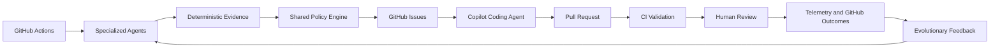

# evolutionary-cicd

### Conference talk: *Evolutionary CI/CD: Building Intelligent Delivery Pipelines with AI Agents*

> Traditional CI/CD executes workflows.
> Agentic CI/CD identifies problems and coordinates implementation.
> Evolutionary CI/CD measures outcomes and improves future delivery decisions.

This repository is a reference implementation for bounded, evidence-backed
CI/CD agents. Agents create structured GitHub Issues through one shared
orchestrator; policy may authorize Copilot Coding Agent to implement an issue
and open a PR. GitHub Actions validates PRs, and humans retain merge and
deployment authority.

> **Disclaimer:** This is an educational conference reference implementation,
> not a production-grade platform. It favors readability and repeatable demos.

## Maturity model

| Stage | Behavior |
|---|---|
| **Traditional CI/CD** | Executes predetermined lint, test, build, and deployment workflows. |
| **Agentic CI/CD** | Specialized agents identify evidence-backed problems and coordinate bounded implementation through reviewed issues and pull requests. |
| **Evolutionary CI/CD** | Measures remediation and delivery outcomes, then uses that evidence to improve future delivery decisions. |

## Architecture



Every agent follows `observe -> reason -> act -> validate -> record`. The
shared orchestrator applies confidence thresholds, stable fingerprints,
deduplication, capability policy, and Copilot assignment authorization. No
agent merges or deploys. See [docs/architecture.md](docs/architecture.md),
[docs/agent-model.md](docs/agent-model.md), and
[docs/security-model.md](docs/security-model.md).

## Agents

| Agent | Purpose | Issue behavior | Copilot assignment |
|---|---|---|---|
| `test_quality_agent` | Reviews test behavior, assertions, isolation, and coverage gaps | Detailed test-quality issue or PR feedback | Allowed by policy |
| `failure_analysis_agent` | Diagnoses failed CI and likely affected files | Evidence-backed failure analysis issue | Allowed by policy |
| `merge_conflict_agent` | Analyzes and validates merge-conflict resolutions | Proposes a reviewed resolution | Allowed by policy |
| `supply_chain_agent` | Reviews dependency and workflow supply-chain evidence | Reports scanner and pinning findings | Allowed by policy |
| `pipeline_optimizer_agent` | Analyzes historical pipeline telemetry | Recommends reviewed workflow improvements | Allowed by policy |
| `flaky_test_agent` | Finds intermittent pytest failures and observed successful reruns | Reports stable test ID, frequency, retry evidence, and hypotheses | Allowed by policy |
| `build_performance_agent` | Finds historical workflow/job duration regressions | Reports samples, baseline, recent duration, and measured optional metrics | Denied by policy |
| `test_impact_agent` | Maps changed modules to direct/transitive tests | Advisory mapping and missing-test issues; never skips mandatory checks | Denied by policy |
| `documentation_drift_agent` | Finds specific undocumented configuration, CLI, and public API changes | Evidence-backed documentation issue | Allowed by policy |
| `agent_effectiveness_agent` | Evaluates issue, PR, merge, verification, and measured outcomes | Reports 90-day metrics and supported quality trends | Denied by policy |

Full triggers, data sources, permissions, examples, thresholds, and issue
behavior are documented in [docs/agent-model.md](docs/agent-model.md).

## Setup

```bash
git clone https://github.com/blockdalegend/evolutionarycicd.git
cd evolutionarycicd
cp .env.example .env
make install
```

Python 3.12 is used by CI. Configure `LLM_API_KEY`, `LLM_BASE_URL`, and
`LLM_MODEL` for the existing LLM-assisted agents. The five new agents use
deterministic calculations and do not require an LLM.

## Local development

```bash
make lint
make typecheck
make test
make security
make ci
```

Five deterministic, write-free demonstrations use checked-in fixture evidence:

```bash
make demo-flaky-test
make demo-build-performance
make demo-test-impact
make demo-documentation-drift
make demo-agent-effectiveness
```

Each prints the finding and proposed issue, whether policy permits Copilot
assignment, and the simulated result. Demo commands force `AGENT_DRY_RUN=true`.
See [docs/demo-scenario.md](docs/demo-scenario.md) for the walkthrough.

Local live mode is separate and requires explicit authorization:

```bash
AGENT_ALLOW_LIVE=true GITHUB_TOKEN=<scoped-token> GITHUB_REPOSITORY=owner/repo \
  python scripts/run_agent.py --agent flaky_test \
  --context-file tests/fixtures/agent_demos/flaky_test.json --live
```

`--live` requires `AGENT_ALLOW_LIVE=true`, a repository, and a token. Do not
use live mode for untrusted PR code. The fixture targets cannot switch out of
dry-run.

## GitHub configuration

All new workflows check out trusted default-branch code and pin Actions by
commit SHA. Historical workflows need `actions: read`, `contents: read`,
`pull-requests: read`, and `issues: write` in their publishing job. PR advisory
jobs remain read-only and force dry-run; their separate manual publishing jobs
default to dry-run. Enable Actions issue creation and set the repository
variable `AGENT_DRY_RUN=false` only after reviewing the permissions.

Copilot assignment requires an authorized `COPILOT_TOKEN` or supported
`GITHUB_TOKEN` access, plus Copilot Coding Agent availability in the
repository. Assignment is recorded as successful only when GitHub confirms the
Copilot bot in the returned assignee list. No workflow automatically merges
or deploys changes.

Cross-run telemetry is uploaded as Actions artifacts with 90-day retention.
The effectiveness evaluator also reads GitHub issue, PR, timeline, and run
metadata. Human operators may apply `agent-remediation-verified` only after
checking acceptance criteria. Apply `agent-measured-target-met` or
`agent-measured-target-missed` only after comparing a documented target with
its measurement. Create those three labels in repository settings before
using them as attestations. A merged PR alone is not a verified remediation.

## Workflows

| Workflow | Trigger | Purpose |
|---|---|---|
| `ci.yml` | PR, push to `main` | Deterministic lint, typecheck, tests, coverage, and security |
| `agent-test-quality.yml` | Existing CI/PR workflow | Test quality review |
| `agent-security.yml` | PR, push to `main` | Supply-chain review |
| `agent-merge-conflict.yml` | Manual dispatch | Conflict analysis |
| `agent-pipeline-analysis.yml` | Manual, weekly | Pipeline optimizer |
| `agent-flaky-test.yml` | After CI, manual, weekly | Historical JUnit analysis |
| `agent-build-performance.yml` | After CI, manual, weekly | Workflow/job timing analysis |
| `agent-test-impact.yml` | PR advisory, manual | Change-to-test mapping |
| `agent-documentation-drift.yml` | PR advisory, manual | Documentation discrepancy analysis |
| `agent-effectiveness.yml` | Manual, weekly | Agent outcome evaluation |

`workflow_run` agents never check out or execute PR code. Artifacts are
downloaded through the GitHub API as bounded data and parsed without executing
their contents. Missing or expired artifacts reduce the available sample;
they are not interpreted as success.

## Repository layout

`agents/` contains the shared `BaseAgent`, ten specialists, and orchestrator.
`tools/github/` contains the GitHub API wrapper. `policies/` defines
capabilities, assignment, and approval rules. `telemetry/` and Actions
artifacts support outcome measurement. `tests/fixtures/agent_demos/` holds
deterministic demo inputs.

## License

[MIT](LICENSE)