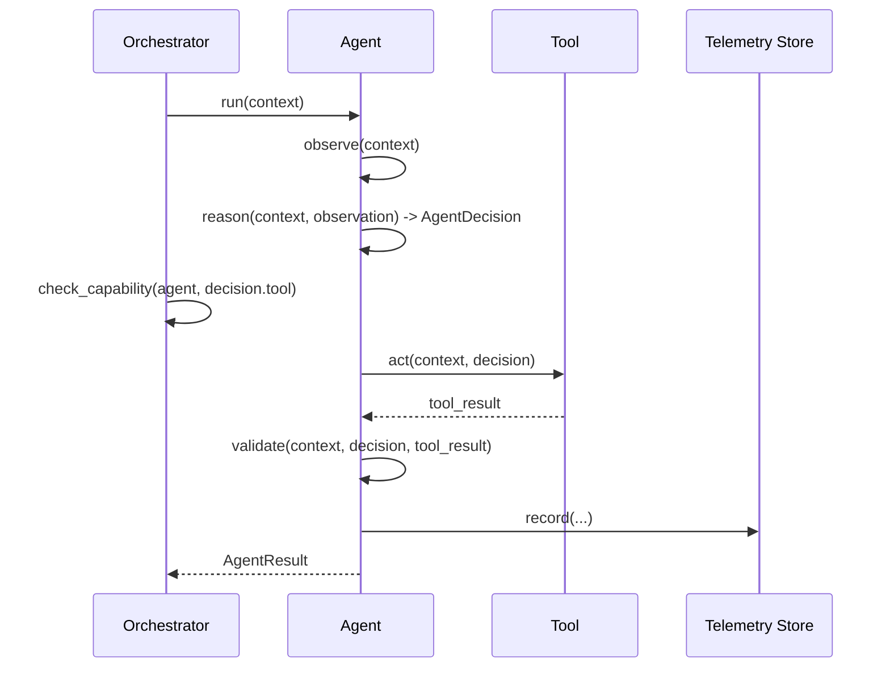

# Agent Model

Every agent in this repository inherits from `agents.base.BaseAgent` and
implements the same five-step lifecycle:

```
observe -> reason -> act -> validate -> record
```



## Core types (`agents/base.py`)

* **`AgentContext`** — everything an agent is allowed to observe: repository,
  PR number, commit SHA, changed files, diff, test results, coverage,
  security findings, and pipeline history. Agents cannot see anything not in
  this object.
* **`AgentDecision`** — the single decision an agent's `reason` step
  produces: `action`, `reason`, an optional `tool` + `arguments`, a
  `confidence` score, and `requires_approval`.
* **`AgentResult`** — the final outcome: `success`, a human-readable
  `message`, `artifacts` (including the raw decision), and
  `validation_results`.
* **`BaseAgent`** — the lifecycle runner. Subclasses only implement
  `observe`, `reason`, `act`, and `validate`; `record` and the overall `run`
  loop are shared.

## Specialized agents

| Agent | Purpose, trigger, and evidence | Finding / issue behavior | Copilot policy and required GitHub permissions | Example use case |
|---|---|---|---|---|
| `test_quality_agent` | Test semantic review; workflow dispatch/PR; diffs, tests, coverage, pytest output | Specific assertion, behavior, or isolation gaps; shared issue/comment path | Assignment allowed by policy; `contents: read`, `pull-requests: write`, `issues: write` when publishing | A new validation branch lacks a focused assertion |
| `failure_analysis_agent` | Diagnose failed CI; after failure/manual; JUnit and pipeline context | Evidence-backed probable cause and affected files | Assignment allowed; `contents: read`, `issues: write`; PR comment capability where enabled | A failed payment test points to a validation regression |
| `merge_conflict_agent` | Conflict evidence; manual dispatch; PR diff and merge-base conflict markers | Proposed resolution and validation outcome, never auto-merged | Assignment allowed; `contents: read`, `issues: write`; no merge permission | Two branches changed the same service method |
| `supply_chain_agent` | Dependency/action security; PR, push, or manual; Bandit, pip-audit, zizmor and workflow files | Unpinned dependency/action or scanner finding | Assignment allowed; `contents: read`, `issues: write`; `pull-requests: write` only for comments | A workflow action uses a mutable tag |
| `pipeline_optimizer_agent` | Historical pipeline analysis; manual/weekly; `pipeline_history.json` and run telemetry | Repeated failures, slow runs, retry patterns, workflow recommendations | Existing policy allows assignment; `contents: read`, `issues: write` | A repeated slow job warrants an optimization proposal |
| `flaky_test_agent` | Intermittent-test analysis; after CI, manual, weekly; historical JUnit artifacts and retry attempts | Stable test ID, failure frequency, successful reruns, repeated error clues; persistent failures are excluded | Allowed; `actions: read`, `contents: read`, `issues: write`, `pull-requests: read` | `test_payment_timeout` fails in 7 of 30 runs but passes in others |
| `build_performance_agent` | Build performance; after CI, manual, weekly; workflow runs/jobs, artifact sizes, optional explicit stage/cache metrics | Baseline/recent means, sample sizes, job or explicitly measured stage regression | Denied; `actions: read`, `contents: read`, `issues: write`, `pull-requests: read` | A recent CI job rises from 120s to 195s |
| `test_impact_agent` | Advisory PR analysis; PR and manual dispatch; changed files, source/test AST imports, dependency relationships | Direct/transitive related tests and unmapped changed modules; never selects required checks to skip | Denied; PR job read-only (`contents`, `pull-requests`, `actions`, `issues` read); dispatch publisher adds `issues: write` | A changed payment module has no mapped test |
| `documentation_drift_agent` | PR/manual; added diff lines, configuration declarations, CLI options, public app APIs, README, `.env.example`, `docs/` | One specific undocumented identifier with source path and documentation gap | Allowed; PR job read-only; trusted dispatch adds `issues: write`; Copilot assignment follows policy | A new `PAYMENT_TIMEOUT_SECONDS` lacks a documented default |
| `agent_effectiveness_agent` | Weekly/manual; 90-day telemetry artifacts plus GitHub issues, linked PRs, validation runs, and human outcome labels | Conversion, acceptance, duplicate, verified-remediation, measured-improvement, latency, and pending/rejected metrics | Denied; `actions: read`, `contents: read`, `issues: write`, `pull-requests: read` | Repeated duplicate findings justify reviewing deterministic thresholds |

All agents use `IssueProposal`, orchestrator confidence policy, stable
fingerprinting, issue reuse, and capability-plus-authority checks. Setting
`assign_copilot: false` in either capability or issue policy always denies
assignment. The agents themselves do not write code, merge pull requests, or
deploy. A Copilot issue assignment is only recorded as successful when the
GitHub API confirms the Copilot bot in the returned assignee list.

The build-performance agent compares a configurable threshold
(`AGENT_BUILD_REGRESSION_THRESHOLD`, default `0.30`) and requires at least
three baseline and three recent samples. It reports cache hit rates, artifact
sizes, or stage durations only when those metrics are explicitly present.
The flaky-test agent requires at least five runs, two failing runs, at least
one passing run, and a failure rate below 80%; it never recommends disabling
or quarantining a test.

The test-impact agent is advisory. Its output is not a test-selection
allowlist, and neither an LLM nor an import heuristic can disable mandatory
checks. Pull request analysis runs with read-only permissions and dry-run;
the separate trusted `workflow_dispatch` publisher is also dry-run by default.

The effectiveness evaluator uses GitHub's `agent-remediation-verified` label
only as an explicit human attestation after acceptance criteria have been
checked. `agent-measured-target-met` and `agent-measured-target-missed`
record comparison outcomes only when a baseline and target exist. Unknown,
pending, rejected, and incomplete work remains distinct; PR creation/merge is
not proof of remediation success.

## Why "Capability != Authority"?

`policies/agent_permissions.yml` says what an agent is *capable* of
attempting (e.g. `test_quality_agent` may attempt `modify_code`).
`policies/approval_rules.yml` says which of those capabilities *require a
human* before they take effect. The orchestrator enforces both: an agent
whose decision references a tool outside its policy entry is rejected
outright (`PolicyViolation`), and any action under
`requires_human_approval` is surfaced as a recommendation, never applied
automatically.
