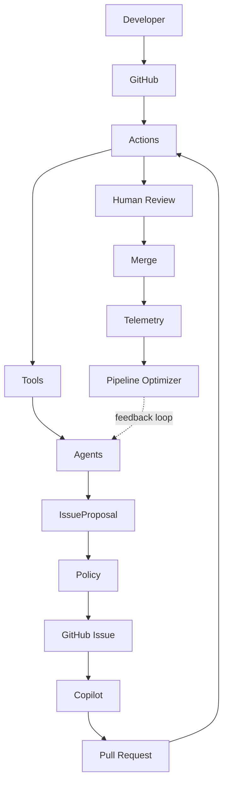

# Architecture

`evolutionary-cicd` keeps GitHub Actions as the single, authoritative
execution engine. Agents observe pipeline state and reason about it, but
every side effect flows through an explicit policy gate and a narrow set of
allowed tools.

```mermaid
flowchart LR
  GHA[GitHub Actions] --> AGENTS[Specialized Agents]
  AGENTS --> EVIDENCE[Deterministic Evidence]
  EVIDENCE --> ORCH[Shared Orchestrator]
  ORCH --> POLICY[Policy Engine]
  POLICY --> ISSUES[GitHub Issues]
  ISSUES --> COPILOT[Copilot Coding Agent]
  COPILOT --> PR[Pull Request]
  PR --> CI[CI Validation]
  CI --> HUMAN[Human Review]
  HUMAN --> TEL[Persistent Run Artifacts + GitHub Metadata]
  TEL --> FEEDBACK[Evolutionary Feedback]
  FEEDBACK --> AGENTS
```

Traditional CI/CD executes predetermined workflows. Agentic CI/CD uses
specialized agents to identify evidence-backed problems and coordinate
implementation through reviewed issues and pull requests. Evolutionary CI/CD
measures what happened after those changes and uses that evidence to improve
future delivery decisions.

## Layers

| Layer | Responsibility | Code |
|---|---|---|
| Deterministic CI | Build, lint, type-check, test, scan | `.github/workflows/ci.yml` |
| Context Builder | Turn GitHub events, bounded workflow artifacts, repository files, and telemetry into an `AgentContext` | `scripts/collect_pipeline_context.py` |
| Orchestrator | Load policy, run one agent, enforce capability checks, post PR comments | `agents/orchestrator/orchestrator.py` |
| Agents | Domain-specific observe/reason/act/validate logic | `agents/*/agent.py` |
| Policy Engine | Declarative capability + approval rules | `policies/*.yml` |
| Tools | The only things an agent may actually invoke | `tools/*` |
| Telemetry | Structured local run record uploaded as an artifact; GitHub API reconciliation provides issue/PR lifecycle outcomes | `telemetry/*`, `data/*.ndjson`, workflow artifacts |
| Evolutionary feedback | Evaluates history, delivery timing, and explicitly attested remediation outcomes | `agents/pipeline_optimizer/agent.py`, `agents/agent_effectiveness/agent.py` |

## Agent inventory

The original five agents and the five additional specialists share the same
`BaseAgent` lifecycle and issue proposal path. New workflow permissions are
scoped per job. The `workflow_run` agents check out trusted default-branch
code and consume upstream JUnit only as size-bounded XML data; they never
execute code from the triggering pull request. PR advisory workflows have
read-only permissions and force dry-run. Manual dispatch is the separate
trusted publishing path.

Historical test results come from the CI workflow's `test-results` artifact.
The collector validates artifact metadata, bounds the archive and XML size,
parses with `defusedxml`, and tolerates expired/missing artifacts. Run and job
durations, artifact size, and explicitly reported stage/cache metrics remain
distinct; no stage metric is inferred from the enclosing job duration.

Agent telemetry is uploaded to a named per-run Actions artifact with a 90-day
retention. The evaluator reconciles marked GitHub issues, cross-referenced
pull requests, merged state, and completed validation runs. It calculates
issue-to-PR, acceptance, duplicate, verification, measured-improvement, and
latency metrics separately. A merge does not imply verified remediation.
Human-applied labels `agent-remediation-verified`,
`agent-measured-target-met`, and `agent-measured-target-missed` are the
explicit attestation inputs for verification and measured outcomes.

## Why this shape?

* **GitHub Actions remains authoritative.** No agent runs outside of, or
  instead of, a workflow step. Agents are just another step.
* **Policy is data, not code.** `policies/agent_permissions.yml` and
  `policies/approval_rules.yml` are read at runtime; changing an agent's
  authority does not require changing Python code.
* **Deterministic tools stay deterministic.** Tests are run by pytest.
  Vulnerabilities are found by Bandit/pip-audit. The LLM is never asked to
  simulate any of these.
# Issue-driven architecture

Specialized agents are discovery agents: they collect deterministic evidence,
reason about it, and emit an `IssueProposal`. The policy engine applies the
confidence threshold, deduplicates fingerprints, and may hand the issue to
Copilot. Copilot opens a PR; Actions validates it and a human merges it.

**The agent proposes the hypothesis. The pipeline provides the evidence.**
Capability != Authority: discovery, implementation, validation, merge, and
deployment remain separate authorities. `VERIFY` records whether a change
technically works; `MEASURE` compares later telemetry to determine whether it
improved delivery.
